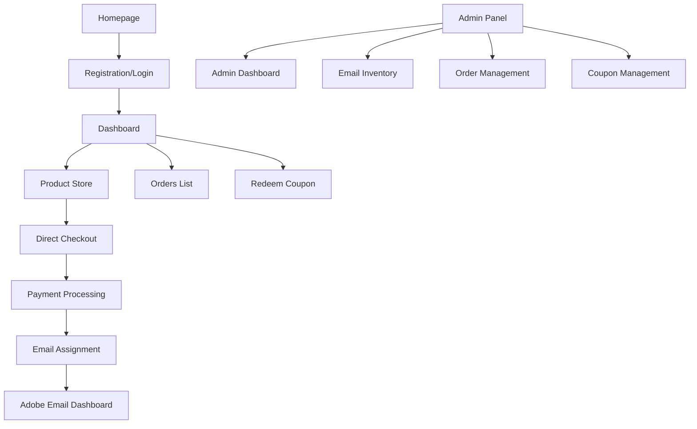

## 1. Product Overview
CreativeDesigner is a modern SaaS platform that enables users to purchase Adobe Creative Cloud subscriptions and automatically receive pre-generated Adobe email accounts. The system automates email distribution, subscription management, and provides comprehensive admin controls for inventory management.

Target market: Creative professionals and businesses in Bangladesh seeking affordable Adobe Creative Cloud access with instant email delivery.

## 2. Core Features

### 2.1 User Roles
| Role | Registration Method | Core Permissions |
|------|---------------------|------------------|
| Customer | Email/password or Google OAuth | Browse products, purchase subscriptions, manage emails, view orders |
| Admin | Manual creation | Manage email inventory, view analytics, manage orders, create coupons |

### 2.2 Feature Module
The CreativeDesigner platform consists of the following main pages:

1. **Dashboard**: Welcome card, statistics overview, notices panel, promotional banners
2. **Product Store**: Grid layout with Adobe product cards, filtering, search functionality
3. **Direct Checkout**: Product summary, payment methods, coupon application, order completion
4. **Adobe Email Dashboard**: Email assignment display, generation controls, tutorial access
5. **Orders List**: Purchase history, status tracking, empty state handling
6. **Redeem Coupon**: License code input, validation, discount application
7. **Admin Dashboard**: Sales analytics, user metrics, email inventory overview
8. **Email Inventory Management**: Bulk upload, status tracking, assignment controls
9. **Order Management**: Order approval/rejection, manual email assignment
10. **Coupon Management**: Create coupons, set discounts, usage limits

### 2.3 Page Details
| Page Name | Module Name | Feature description |
|-----------|-------------|---------------------|
| Dashboard | Welcome Section | Display user avatar, greeting message, sign out button |
| Dashboard | Statistics Cards | Show Total Orders, Total Spent, Active Subscriptions, Wallet Balance with animated wave effects |
| Dashboard | Notices Panel | Display admin-controlled announcements with timestamps |
| Dashboard | Promo Banners | Show promotional content with Adobe app icons and mixed Bangla/English text |
| Product Store | Product Grid | Display 3-column grid of subscription cards with gradient banners |
| Product Store | Product Card | Show Adobe icons, title (Bangla supported), description, price, Buy Now button |
| Product Store | Filter Controls | Toggle Adobe/Envato products, search bar with real-time filtering |
| Product Store | Hover Effects | Apply scale transformation, glow effect, and shadow on card hover |
| Direct Checkout | Product Summary | Display selected product details, original price, total with VAT |
| Direct Checkout | Payment Methods | Show bKash, Nagad, Rocket, Stripe icons with selection validation |
| Direct Checkout | Coupon System | Input field for discount codes with apply button and validation |
| Direct Checkout | Step Indicator | Visual progress from Customer Info to Payment Method selection |
| Direct Checkout | Action Buttons | Back navigation and Pay Now with purple gradient styling |
| Adobe Email Dashboard | Status Banner | Show subscription status with redeem license and buy now buttons |
| Adobe Email Dashboard | Email Display | List assigned Adobe emails with copy functionality and status |
| Adobe Email Dashboard | Generate Control | Button to create backup emails (max 3/month) with quota checking |
| Adobe Email Dashboard | Quick Actions | Tutorial, Mail Access buttons with icon integration |
| Orders List | Order History | Display all purchases with status badges (Pending/Completed) |
| Orders List | Search & Filter | Search by order details, filter by status with icon indicators |
| Orders List | Empty State | Show cart icon with "No orders yet" message |
| Redeem Coupon | Code Input | Single input field with redeem button and validation feedback |
| Redeem Coupon | Result Display | Show applied discount or error messages |
| Admin Dashboard | Analytics Overview | Display total sales, active users, emails used/remaining metrics |
| Email Inventory | Bulk Upload | Upload CSV files with email,password format |
| Email Inventory | Status Management | Track Available/Assigned/Used status for each email |
| Email Inventory | Assignment Control | Manual assignment and reassignment capabilities |
| Order Management | Order List | View all orders with manual status update controls |
| Order Management | Manual Actions | Trigger email assignment, approve/reject orders |
| Coupon Management | Creation Form | Set discount percentage, expiry date, usage limits |
| Coupon Management | Active Coupons | List existing coupons with usage statistics |

## 3. Core Process

### User Flow
1. User registers via email/password or Google OAuth
2. User browses Adobe products in the store with filtering options
3. User selects product and proceeds to direct checkout
4. User completes payment using local methods (bKash, Nagad, Rocket) or Stripe
5. System automatically assigns available Adobe email from pool
6. User accesses Adobe Email Dashboard to view credentials
7. User can generate up to 3 backup emails per month per subscription
8. User tracks orders and manages subscriptions through dashboard

### Admin Flow
1. Admin uploads bulk email inventory via CSV upload
2. Admin monitors sales analytics and user activity
3. Admin manages order approvals and manual email assignments
4. Admin creates and manages discount coupons
5. Admin posts important notices for users

## 4. User Interface Design

### 4.1 Design Style
- **Primary Colors**: Purple gradient (#8B5CF6 to #EC4899)
- **Secondary Colors**: Orange (#F97316), Pink (#EC4899), Soft gray (#f5f7fb)
- **Button Style**: Rounded-xl with gradient backgrounds, ripple effects on click
- **Typography**: Clean sans-serif, varying weights (400-700)
- **Layout**: Card-based design with rounded corners (rounded-xl)
- **Icons**: Line-outline style with purple accent for active states
- **Background**: Soft gray (#f5f7fb) with white cards

### 4.2 Page Design Overview
| Page Name | Module Name | UI Elements |
|-----------|-------------|-------------|
| Dashboard | Welcome Card | White rounded card with user avatar circle, greeting text, sign out button |
| Dashboard | Stats Cards | 4 white cards with subtle wave animations, purple accent colors |
| Dashboard | Notices | White card with info tags, Bangla/English mixed content, timestamps |
| Product Store | Product Grid | 3-column responsive grid, gradient banners with rainbow effect |
| Product Store | Product Cards | Adobe app icons, Bangla titles, hover scale + glow effects |
| Direct Checkout | Summary Card | White rounded card with order details, purple total price display |
| Direct Checkout | Payment Methods | Icon grid for local payment methods, validation states |
| Adobe Email | Status Banner | White card with red tint header, action buttons with icons |
| Adobe Email | Email List | Clean table format with copy buttons, status indicators |
| Orders | List View | White card with search bar, filter icon, status badges |

### 4.3 Responsiveness
- **Desktop-First Approach**: Optimized for 1920x1080 and above
- **Mobile Adaptation**: Responsive breakpoints at 768px and 480px
- **Touch Optimization**: Larger tap targets on mobile, swipe gestures for navigation
- **Collapsible Sidebar**: Auto-collapse on mobile, hamburger menu integration

### 4.4 Animation Guidelines
- **Page Transitions**: Fade + slide animations (0.3s duration)
- **Card Hover**: Scale(1.05) + box-shadow increase + subtle glow
- **Button Interactions**: Ripple effect from click point
- **Loading States**: Skeleton screens with wave animations
- **Toast Notifications**: Slide-in from top-right with auto-dismiss