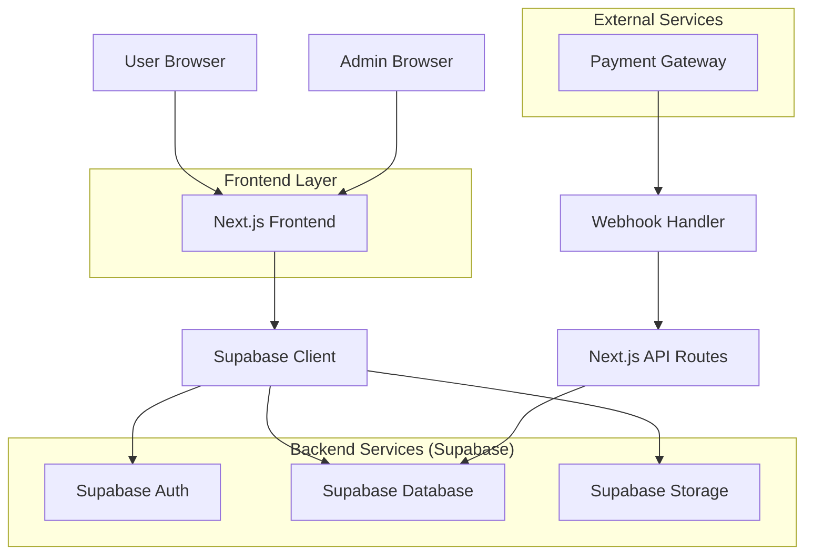
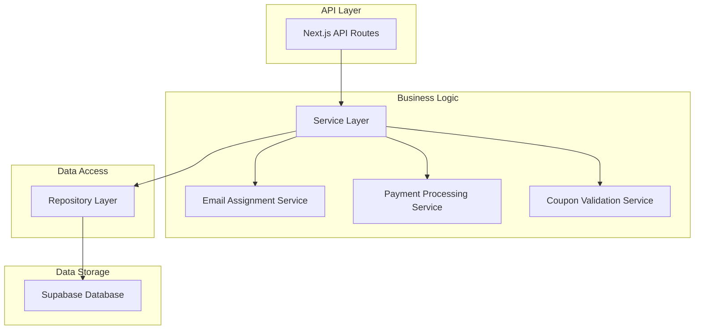
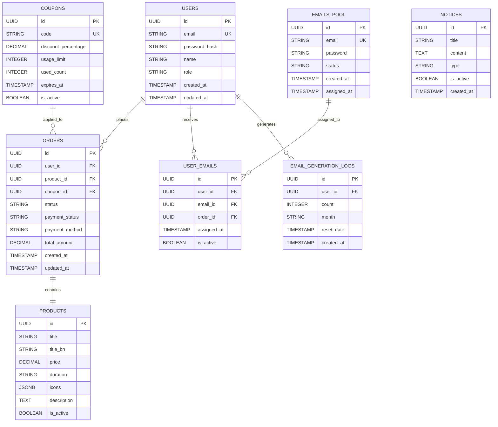

## 1. Architecture Design



## 2. Technology Description

- **Frontend**: Next.js@14 + React@18 + TypeScript
- **Styling**: TailwindCSS@3 + Framer Motion
- **Database**: Supabase (PostgreSQL)
- **Authentication**: Supabase Auth (JWT-based)
- **File Upload**: Supabase Storage
- **Payment Processing**: SSLCommerz/bKash APIs + Stripe
- **Initialization Tool**: create-next-app

## 3. Route Definitions

| Route | Purpose |
|-------|---------|
| / | Landing page with product showcase |
| /auth/login | User authentication page |
| /auth/register | User registration page |
| /dashboard | User dashboard with statistics |
| /store | Product listing page |
| /checkout/[productId] | Direct checkout flow |
| /orders | Order history and tracking |
| /adobe-emails | Adobe email management dashboard |
| /redeem-coupon | Coupon redemption page |
| /admin | Admin dashboard overview |
| /admin/emails | Email inventory management |
| /admin/orders | Order management panel |
| /admin/coupons | Coupon creation and management |
| /api/webhooks/payment | Payment gateway webhooks |
| /api/auth/callback | OAuth callback handler |

## 4. API Definitions

### 4.1 Authentication APIs

```
POST /api/auth/login
```

Request:
| Param Name | Param Type | isRequired | Description |
|------------|-------------|-------------|-------------|
| email | string | true | User email address |
| password | string | true | User password |

Response:
```json
{
  "user": {
    "id": "uuid",
    "email": "user@example.com",
    "name": "User Name"
  },
  "session": {
    "access_token": "jwt_token",
    "expires_in": 3600
  }
}
```

### 4.2 Product APIs

```
GET /api/products
```

Response:
```json
{
  "products": [
    {
      "id": "uuid",
      "title": "Adobe Creative Cloud",
      "title_bn": "অ্যাডোবি ক্রিয়েটিভ ক্লাউড",
      "price": 250,
      "duration": "1 month",
      "icons": ["ai", "ps", "pr", "ae"],
      "description": "Complete creative package"
    }
  ]
}
```

### 4.3 Order APIs

```
POST /api/orders/create
```

Request:
| Param Name | Param Type | isRequired | Description |
|------------|-------------|-------------|-------------|
| product_id | string | true | Product UUID |
| payment_method | string | true | bKash/Nagad/Rocket/Stripe |
| coupon_code | string | false | Discount coupon |

Response:
```json
{
  "order": {
    "id": "uuid",
    "status": "pending",
    "total": 250,
    "payment_url": "https://payment-gateway.com/checkout"
  }
}
```

### 4.4 Email Generation APIs

```
POST /api/emails/generate
```

Request:
| Param Name | Param Type | isRequired | Description |
|------------|-------------|-------------|-------------|
| subscription_id | string | true | Active subscription UUID |

Response:
```json
{
  "email": {
    "id": "uuid",
    "email": "user123@adobe.com",
    "password": "secure_password",
    "assigned_at": "2026-03-31T12:00:00Z"
  },
  "remaining_quota": 2
}
```

## 5. Server Architecture Diagram



## 6. Data Model

### 6.1 Data Model Definition



### 6.2 Data Definition Language

```sql
-- Users table
CREATE TABLE users (
    id UUID PRIMARY KEY DEFAULT gen_random_uuid(),
    email VARCHAR(255) UNIQUE NOT NULL,
    password_hash VARCHAR(255) NOT NULL,
    name VARCHAR(100) NOT NULL,
    role VARCHAR(20) DEFAULT 'user' CHECK (role IN ('user', 'admin')),
    created_at TIMESTAMP WITH TIME ZONE DEFAULT NOW(),
    updated_at TIMESTAMP WITH TIME ZONE DEFAULT NOW()
);

-- Products table
CREATE TABLE products (
    id UUID PRIMARY KEY DEFAULT gen_random_uuid(),
    title VARCHAR(255) NOT NULL,
    title_bn VARCHAR(255),
    price DECIMAL(10,2) NOT NULL,
    duration VARCHAR(50) NOT NULL,
    icons JSONB DEFAULT '[]',
    description TEXT,
    is_active BOOLEAN DEFAULT true,
    created_at TIMESTAMP WITH TIME ZONE DEFAULT NOW()
);

-- Orders table
CREATE TABLE orders (
    id UUID PRIMARY KEY DEFAULT gen_random_uuid(),
    user_id UUID REFERENCES users(id) ON DELETE CASCADE,
    product_id UUID REFERENCES products(id) ON DELETE CASCADE,
    coupon_id UUID REFERENCES coupons(id) ON DELETE SET NULL,
    status VARCHAR(20) DEFAULT 'pending' CHECK (status IN ('pending', 'paid', 'completed', 'cancelled')),
    payment_status VARCHAR(20) DEFAULT 'pending' CHECK (payment_status IN ('pending', 'paid', 'failed')),
    payment_method VARCHAR(50) NOT NULL,
    total_amount DECIMAL(10,2) NOT NULL,
    created_at TIMESTAMP WITH TIME ZONE DEFAULT NOW(),
    updated_at TIMESTAMP WITH TIME ZONE DEFAULT NOW()
);

-- Emails Pool table
CREATE TABLE emails_pool (
    id UUID PRIMARY KEY DEFAULT gen_random_uuid(),
    email VARCHAR(255) UNIQUE NOT NULL,
    password VARCHAR(255) NOT NULL,
    status VARCHAR(20) DEFAULT 'available' CHECK (status IN ('available', 'assigned', 'used')),
    created_at TIMESTAMP WITH TIME ZONE DEFAULT NOW(),
    assigned_at TIMESTAMP WITH TIME ZONE
);

-- User Emails table
CREATE TABLE user_emails (
    id UUID PRIMARY KEY DEFAULT gen_random_uuid(),
    user_id UUID REFERENCES users(id) ON DELETE CASCADE,
    email_id UUID REFERENCES emails_pool(id) ON DELETE CASCADE,
    order_id UUID REFERENCES orders(id) ON DELETE CASCADE,
    assigned_at TIMESTAMP WITH TIME ZONE DEFAULT NOW(),
    is_active BOOLEAN DEFAULT true,
    UNIQUE(email_id)
);

-- Email Generation Logs table
CREATE TABLE email_generation_logs (
    id UUID PRIMARY KEY DEFAULT gen_random_uuid(),
    user_id UUID REFERENCES users(id) ON DELETE CASCADE,
    count INTEGER DEFAULT 0,
    month VARCHAR(7) NOT NULL, -- Format: YYYY-MM
    reset_date TIMESTAMP WITH TIME ZONE,
    created_at TIMESTAMP WITH TIME ZONE DEFAULT NOW(),
    UNIQUE(user_id, month)
);

-- Coupons table
CREATE TABLE coupons (
    id UUID PRIMARY KEY DEFAULT gen_random_uuid(),
    code VARCHAR(50) UNIQUE NOT NULL,
    discount_percentage DECIMAL(5,2) NOT NULL CHECK (discount_percentage > 0 AND discount_percentage <= 100),
    usage_limit INTEGER DEFAULT 1,
    used_count INTEGER DEFAULT 0,
    expires_at TIMESTAMP WITH TIME ZONE,
    is_active BOOLEAN DEFAULT true,
    created_at TIMESTAMP WITH TIME ZONE DEFAULT NOW()
);

-- Notices table
CREATE TABLE notices (
    id UUID PRIMARY KEY DEFAULT gen_random_uuid(),
    title VARCHAR(255) NOT NULL,
    content TEXT NOT NULL,
    type VARCHAR(20) DEFAULT 'info' CHECK (type IN ('info', 'warning', 'error')),
    is_active BOOLEAN DEFAULT true,
    created_at TIMESTAMP WITH TIME ZONE DEFAULT NOW()
);

-- Create indexes for performance
CREATE INDEX idx_users_email ON users(email);
CREATE INDEX idx_orders_user_id ON orders(user_id);
CREATE INDEX idx_orders_status ON orders(status);
CREATE INDEX idx_orders_created_at ON orders(created_at DESC);
CREATE INDEX idx_user_emails_user_id ON user_emails(user_id);
CREATE INDEX idx_user_emails_email_id ON user_emails(email_id);
CREATE INDEX idx_emails_pool_status ON emails_pool(status);
CREATE INDEX idx_email_generation_logs_user_id ON email_generation_logs(user_id);
CREATE INDEX idx_email_generation_logs_month ON email_generation_logs(month);

-- Set up Row Level Security (RLS)
ALTER TABLE users ENABLE ROW LEVEL SECURITY;
ALTER TABLE orders ENABLE ROW LEVEL SECURITY;
ALTER TABLE user_emails ENABLE ROW LEVEL SECURITY;
ALTER TABLE email_generation_logs ENABLE ROW LEVEL SECURITY;

-- Create policies
CREATE POLICY "Users can view own profile" ON users FOR SELECT USING (auth.uid() = id);
CREATE POLICY "Users can update own profile" ON users FOR UPDATE USING (auth.uid() = id);
CREATE POLICY "Users can view own orders" ON orders FOR SELECT USING (auth.uid() = user_id);
CREATE POLICY "Users can create orders" ON orders FOR INSERT WITH CHECK (auth.uid() = user_id);
CREATE POLICY "Users can view own emails" ON user_emails FOR SELECT USING (auth.uid() = user_id);
CREATE POLICY "Users can view own generation logs" ON email_generation_logs FOR SELECT USING (auth.uid() = user_id);

-- Admin policies
CREATE POLICY "Admins can view all users" ON users FOR SELECT USING (EXISTS (
    SELECT 1 FROM users WHERE id = auth.uid() AND role = 'admin'
));
CREATE POLICY "Admins can manage all orders" ON orders FOR ALL USING (EXISTS (
    SELECT 1 FROM users WHERE id = auth.uid() AND role = 'admin'
));
CREATE POLICY "Admins can manage email pool" ON emails_pool FOR ALL USING (EXISTS (
    SELECT 1 FROM users WHERE id = auth.uid() AND role = 'admin'
));

-- Grant permissions
GRANT SELECT ON users TO anon;
GRANT SELECT ON products TO anon;
GRANT INSERT ON users TO anon;
GRANT ALL ON users TO authenticated;
GRANT ALL ON orders TO authenticated;
GRANT ALL ON user_emails TO authenticated;
GRANT ALL ON email_generation_logs TO authenticated;
GRANT ALL ON emails_pool TO authenticated;
GRANT ALL ON coupons TO authenticated;
GRANT ALL ON notices TO authenticated;
```

## 7. Security Implementation

### 7.1 Authentication Security
- JWT tokens with 1-hour expiration
- Refresh token rotation
- Secure password hashing with bcrypt
- Rate limiting on authentication endpoints

### 7.2 API Security
- CORS configuration for allowed origins
- Input validation and sanitization
- SQL injection prevention via parameterized queries
- XSS protection with content security policies

### 7.3 Email System Security
- Rate limiting: 3 emails per month per subscription
- Email assignment validation
- Secure credential storage
- Access logging for audit trails

### 7.4 Payment Security
- PCI DSS compliance for payment processing
- Webhook signature verification
- Encrypted payment data transmission
- Fraud detection mechanisms