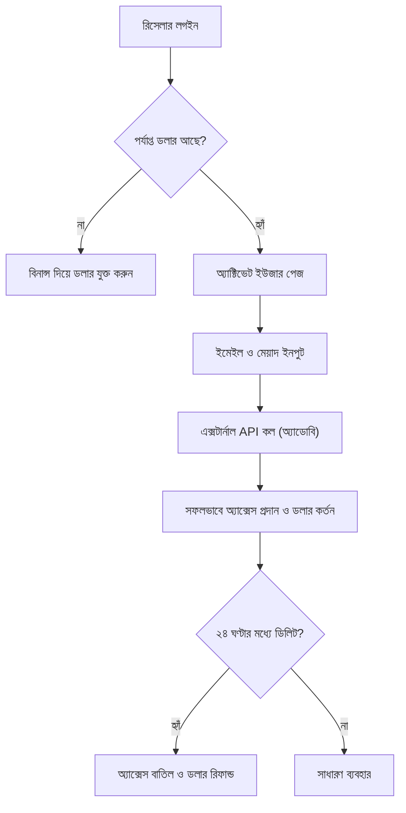

## ১. প্রোডাক্ট ওভারভিউ (Product Overview)
অ্যাডোবি ক্রিয়েটিভ ক্লাউড রিসেলার প্যানেল (Adobe Creative Cloud Reseller Panel) হলো একটি আধুনিক, মিনিমালিস্টিক এবং সুন্দর ডিজাইনের ওয়েব অ্যাপ্লিকেশন। এর মাধ্যমে রিসেলাররা তাদের ব্যবহারকারীদের অ্যাডোবি ক্রিয়েটিভ ক্লাউডের অ্যাক্সেস প্রদান করতে পারবে।
- মূল উদ্দেশ্য হলো রিসেলারদের জন্য একটি ড্যাশবোর্ড তৈরি করা, যেখান থেকে তারা ইমেইল যোগ করে অ্যাডোবি অ্যাক্সেস দিতে পারবে। এই সিস্টেমে ক্রেডিট-এর বদলে 'ডলার' (Dollar) সিস্টেম ব্যবহার করা হবে এবং ফান্ড যুক্ত করার জন্য বিনান্স (Binance) পেমেন্ট গেটওয়ে ব্যবহৃত হবে।

## ২. কোর ফিচারসমূহ (Core Features)

### ২.১ ইউজার রোল (User Roles)
| রোল (Role) | রেজিস্ট্রেশন পদ্ধতি | কোর পারমিশন (Core Permissions) |
|------|---------------------|------------------|
| রিসেলার (Reseller) | অ্যাডমিন কর্তৃক বা সাইন-আপ | ব্যবহারকারী যোগ/মুছে ফেলা, ব্যালেন্স দেখা, বিনান্স দিয়ে ডলার রিচার্জ |
| অ্যাডমিন (Admin) | প্রি-ডিফাইনড | রিসেলার পরিচালনা, ট্রানজেকশন মনিটরিং, সিস্টেম সেটিংস |

### ২.২ ফিচার মডিউল (Feature Module)
১. **রিসেলার ড্যাশবোর্ড (Reseller Dashboard)**: ডলার ব্যালেন্স, অ্যাক্টিভ ইউজার সংখ্যা, রিফান্ড স্ট্যাটাস।
২. **অ্যাক্টিভেট ইউজার (Activate User)**: নতুন ব্যবহারকারীর ইমেইল এবং মেয়াদ (১-১২ মাস, ৭ দিন, ১৪ দিন) যোগ করে অ্যাক্সেস দেওয়া।
৩. **মাই ইউজার্স (My Users)**: অ্যাক্টিভ ব্যবহারকারীদের তালিকা, স্ট্যাটাস, এবং ২৪ ঘণ্টার মধ্যে ডিলিট করে রিফান্ড নেওয়ার সুবিধা।
৪. **ফান্ড অ্যাড (Add Funds)**: বিনান্স পেমেন্ট গেটওয়ের মাধ্যমে অ্যাকাউন্টে ডলার যুক্ত করা।

### ২.৩ পেজ ডিটেইলস (Page Details)
| পেজের নাম (Page Name) | মডিউলের নাম (Module Name) | ফিচারের বিবরণ (Feature Description) |
|-----------|-------------|---------------------|
| Dashboard | Overview Cards | বর্তমান ডলার ব্যালেন্স, মোট অ্যাক্টিভ ইউজার এবং দ্রুত অ্যাকশন বাটন। |
| Activate User | Form Module | ইমেইল এবং ডিউরেশন সিলেক্ট করে অ্যাডোবি অ্যাক্সেস দেওয়ার ফর্ম। |
| User List | Data Table | ব্যবহারকারীদের তালিকা, মেয়াদোত্তীর্ণের তারিখ এবং ডিলিট (রিফান্ড) বাটন। |
| Add Funds | Payment Module | বিনান্স পে (Binance Pay) কিউআর কোড বা পেমেন্ট ইন্টিগ্রেশন। |

## ৩. কোর প্রসেস (Core Process)
রিসেলার ড্যাশবোর্ডে লগইন করে প্রথমে বিনান্সের মাধ্যমে ডলার অ্যাড করবে। এরপর 'Activate User' পেজে গিয়ে গ্রাহকের ইমেইল ও মেয়াদ সিলেক্ট করে অ্যাক্সেস প্রদান করবে। ব্যাকএন্ডে এটি এক্সটার্নাল API-এর মাধ্যমে অ্যাডোবিতে যুক্ত হবে। ২৪ ঘণ্টার মধ্যে গ্রাহককে রিমুভ করলে রিসেলারের অ্যাকাউন্টে ডলার রিফান্ড হয়ে যাবে।

## ৪. ইউজার ইন্টারফেস ডিজাইন (User Interface Design)

### ৪.১ ডিজাইন স্টাইল (Design Style)
- **থিম**: প্রিমিয়াম ডার্ক থিম (Premium Dark Theme) বা গ্লাস-মরফিজম (Glassmorphism) স্টাইল। অত্যন্ত পরিপাটি এবং আধুনিক।
- **রং (Colors)**: ডিপ নেভি ব্লু/ব্ল্যাক ব্যাকগ্রাউন্ড, অ্যাকসেন্ট হিসেবে ইলেকট্রিক ব্লু এবং সাকসেস/ওয়ার্নিং মেসেজের জন্য নিয়ন গ্রিন/রেড।
- **বাটন স্টাইল**: সফট শ্যাডো, রাউন্ডেড কর্নার (Rounded), হোভার ইফেক্টসহ স্মুথ ট্রানজিশন।
- **ফন্ট (Fonts)**: 'Inter' বা 'Plus Jakarta Sans'-এর মতো আধুনিক স্যান্স-সেরিফ ফন্ট।
- **লেআউট**: কার্ড-ভিত্তিক (Card-based), সাইডবার নেভিগেশন, প্রচুর নেগেটিভ স্পেস (Negative Space) ব্যবহার করে মিনিমাল লুক।

### ৪.২ পেজ ডিজাইন ওভারভিউ (Page Design Overview)
| পেজের নাম | মডিউলের নাম | ইউজার ইন্টারফেস উপাদান (UI Elements) |
|-----------|-------------|-------------|
| Dashboard | Stats Grid | ব্লার ইফেক্টসহ গ্লাস কার্ড, বড় ফন্ট সাইজের ব্যালেন্স, গ্রাফ। |
| Activate | Input Form | ফ্লোটিং লেবেল, কাস্টম ড্রপডাউন, রিয়েল-টাইম প্রাইস ক্যালকুলেটর। |
| My Users | Table | স্টিকি হেডার, ব্যাজ (Badge) স্ট্যাটাস, কাস্টম অ্যাকশন মেনু। |

### ৪.৩ রেসপন্সিভনেস (Responsiveness)
- ডেক্সটপ-ফার্স্ট (Desktop-first) ডিজাইন, তবে মোবাইল এবং ট্যাবলেটের জন্য সম্পূর্ণ অপ্টিমাইজড (Mobile-adaptive)। টাচ-ফ্রেন্ডলি বাটন এবং স্ক্রলএবল টেবিল।
