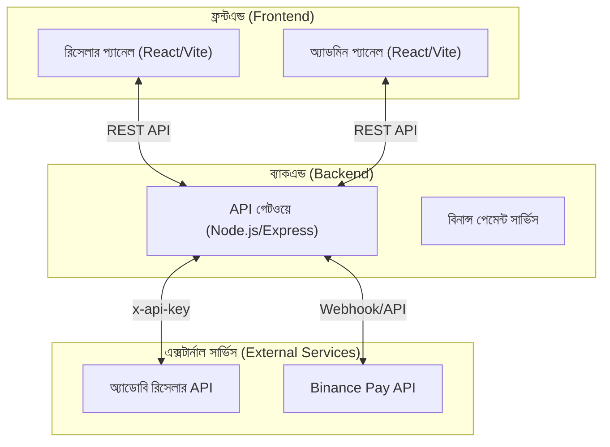
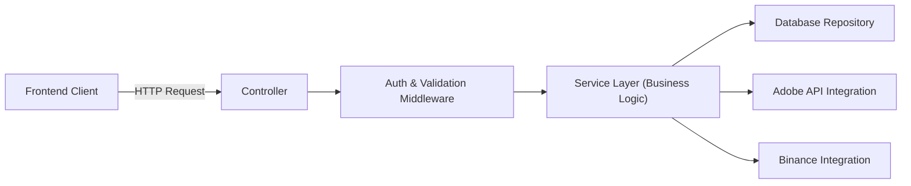
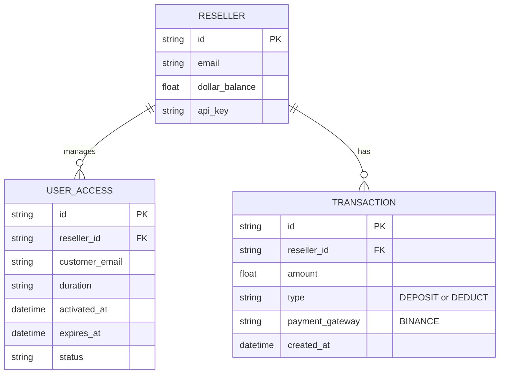

## ১. আর্কিটেকচার ডিজাইন (Architecture Design)



## ২. টেকনোলজি ডেসক্রিপশন (Technology Description)
- **ফ্রন্টএন্ড (Frontend)**: React 18, Tailwind CSS v3, Vite, Framer Motion (অ্যানিমেশনের জন্য), React Router DOM।
- **ডিজাইন সিস্টেম**: Shadcn UI বা কাস্টম Tailwind কম্পোনেন্ট (প্রিমিয়াম লুকের জন্য), Lucide Icons।
- **লুসিভ অ্যানিমেশন**: পেজ লোড এবং ইন্টারঅ্যাকশনের জন্য স্মুথ CSS এবং Framer Motion ট্রানজিশন।
- **ইনিশিয়ালাইজেশন টুল**: vite-init

## ৩. রাউট ডেফিনেশন (Route Definitions)
| রাউট (Route) | উদ্দেশ্য (Purpose) |
|-------|---------|
| `/` | লগইন পেজ |
| `/dashboard` | রিসেলার ড্যাশবোর্ড (ব্যালেন্স, স্ট্যাটাস) |
| `/activate` | নতুন ব্যবহারকারী যুক্ত করার ফর্ম |
| `/users` | অ্যাক্টিভ এবং মেয়াদোত্তীর্ণ ব্যবহারকারীদের তালিকা |
| `/add-funds` | বিনান্সের মাধ্যমে ডলার রিচার্জ করার পেজ |

## ৪. API ডেফিনেশন (API Definitions)
*নোট: এই API গুলো ব্যাকএন্ডের জন্য, যা ফ্রন্টএন্ড থেকে কল করা হবে।*

```typescript
// ব্যবহারকারী যোগ করা
interface AddUserRequest {
  email: string;
  durationMonths: string; // "1" to "12", "7d", "14d"
  products?: string[];
}

interface AddUserResponse {
  success: boolean;
  message: string;
  user: {
    email: string;
    durationDays: number;
    activatedAt: string;
    expiresAt: string;
  };
  balanceRemaining: number; // ডলারে কনভার্ট করা
}

// ফান্ড অ্যাড করা (বিনান্স)
interface AddFundRequest {
  amountUsd: number;
}
interface AddFundResponse {
  paymentUrl: string;
  orderId: string;
}
```

## ৫. সার্ভার আর্কিটেকচার ডায়াগ্রাম (Server Architecture Diagram)



## ৬. ডেটা মডেল (Data Model)
### ৬.১ ডেটা মডেল ডেফিনেশন (Data Model Definition)


